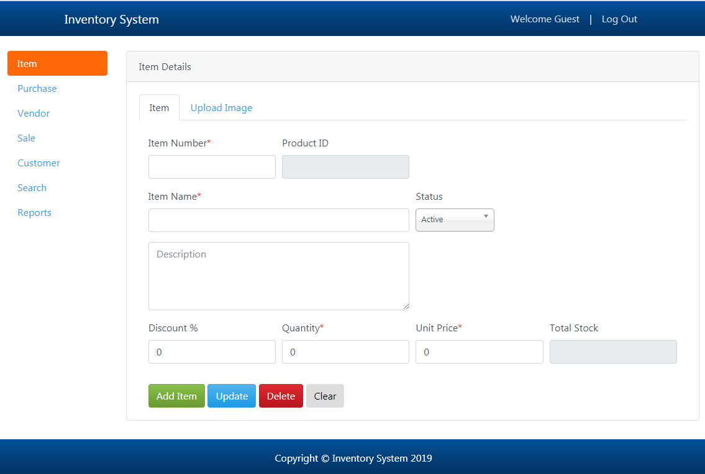
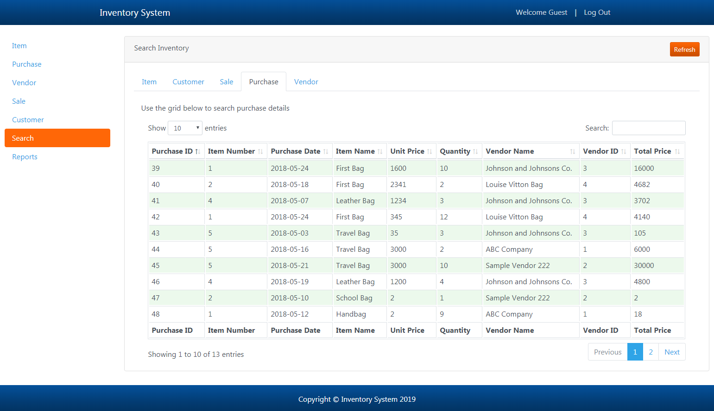
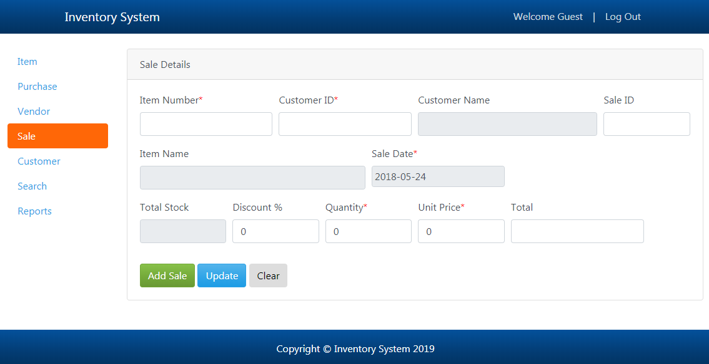
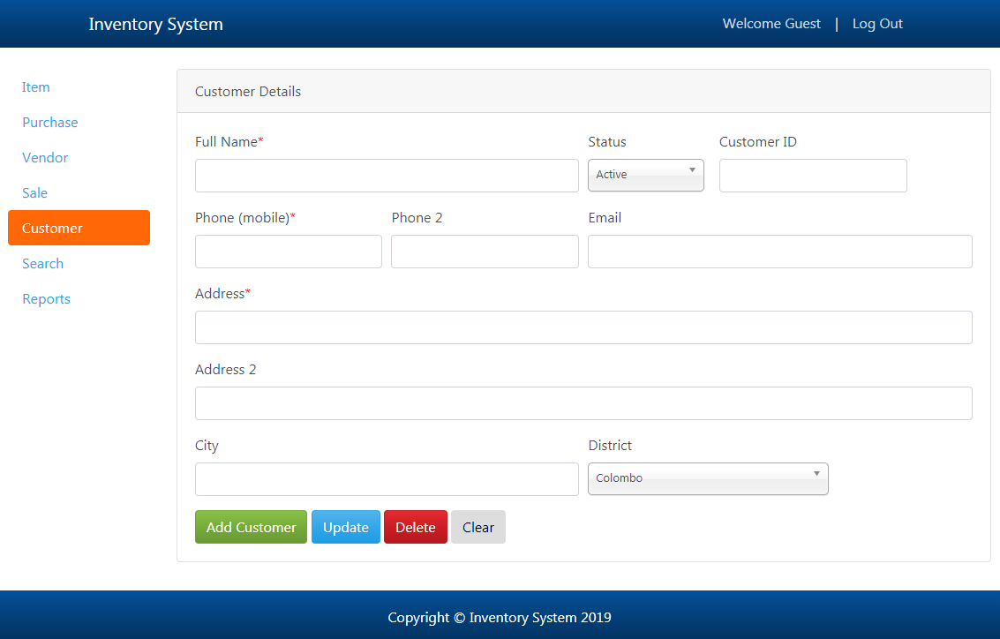
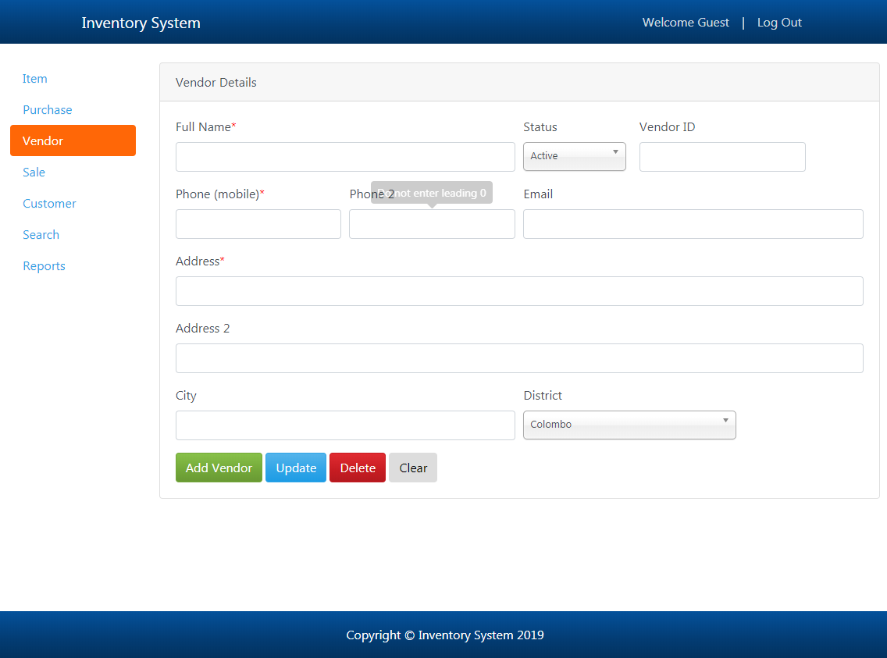

# Assets & Inventory Management System


A web-based **Assets & Inventory Management System** built with **PHP, MySQL, HTML5, JavaScript, and Bootstrap**. Designed for small to medium enterprises to efficiently track inventory stock, sales, purchases, vendors, and customers with interactive reporting.

---

## 📸 Application Screenshots

| Item Management | Inventory Search |
| :---: | :---: |
|  |  |

| Sales Details | Customer Details |
| :---: | :---: |
|  |  |

| Vendor Management |
| :---: |
|  |

---

## 🌟 Key Features

- 📦 **Item & Asset Management**: Track product IDs, serial numbers, stock levels, unit pricing, discounts, and image attachments.
- 🛒 **Purchase Tracking**: Manage incoming inventory purchases linked to vendors with automatic stock updates.
- 💰 **Sales Operations**: Process outgoing customer sales, track transaction dates, unit prices, and dynamic totals.
- 🏢 **Vendor & Customer Management**: Maintain detailed profiles, contact numbers, email, address, and active status for vendors and customers.
- 🔍 **Real-Time Data Search**: Instant searching across items, sales, purchases, vendors, and customers using integrated DataTables.
- 📊 **Dynamic Reports**: Generate comprehensive sales and purchase reports filtered by custom date ranges.
- 🔐 **Authentication & Session Security**: Built-in login authentication system.

---

## 🛠️ Technology Stack

- **Backend**: PHP (PDO / MySQLi), Session Authentication
- **Frontend**: HTML5, CSS3, JavaScript (ES6), jQuery, Bootstrap 4
- **UI Components**: DataTables, Chosen Select, Bootstrap Datepicker, Bootbox.js
- **Database**: MySQL / MariaDB

---

## 🚀 Quick Setup & Installation

### Prerequisites
- Web Server (Apache via [XAMPP](https://www.apachefriends.org/), WAMP, or LAMP stack)
- PHP 7.4+ / PHP 8.x
- MySQL / MariaDB Database Server

### Step-by-Step Setup

1. **Clone the Repository**
   ```bash
   git clone git@github.com:aayush2411ghoghari-sketch/Assets-manager.git
   ```
   *Deploy the cloned folder inside your web server's root directory (e.g., `C:\xampp\htdocs\ASSETS_MANAGER` for XAMPP).*

2. **Database Configuration**
   - Open PHPMyAdmin (`http://localhost/phpmyadmin`) or your MySQL client.
   - Create a new database named `shop_inventory`.
   - Import the `shop_inventory.sql` file located in the root directory into the `shop_inventory` database.

3. **Configure Database Connection**
   - Check `inc/config/constants.php` and set your base URL and MySQL credentials:
     ```php
     define('DB_HOST', 'localhost');
     define('DB_USER', 'root');
     define('DB_PASSWORD', '');
     define('DB_NAME', 'shop_inventory');
     ```

4. **Launch Application**
   - Open your web browser and navigate to:
     ```
     http://localhost/ASSETS_MANAGER/login.php
     ```

### 🔑 Default Credentials
- **Username**: `guest`
- **Password**: `1234`

---

## 📁 Directory Structure

```
ASSETS_MANAGER/
├── assets/          # Custom CSS, JS, and uploaded item images
├── data/            # Application data files
├── inc/             # Configuration, layout headers/footers, navigation
├── model/           # Core PHP business logic (CRUD operations & DataTables handlers)
├── screenshots/     # Application visual previews & UI screenshots
├── vendor/          # Frontend libraries (Bootstrap, jQuery, DataTables, etc.)
├── shop_inventory.sql # Database schema & seed data
├── index.php        # Main dashboard interface
├── login.php        # Login authentication view
├── LICENSE.md       # MIT License
└── README.md        # Project documentation
```

---

## 📄 License

This project is licensed under the [MIT License](LICENSE.md).
